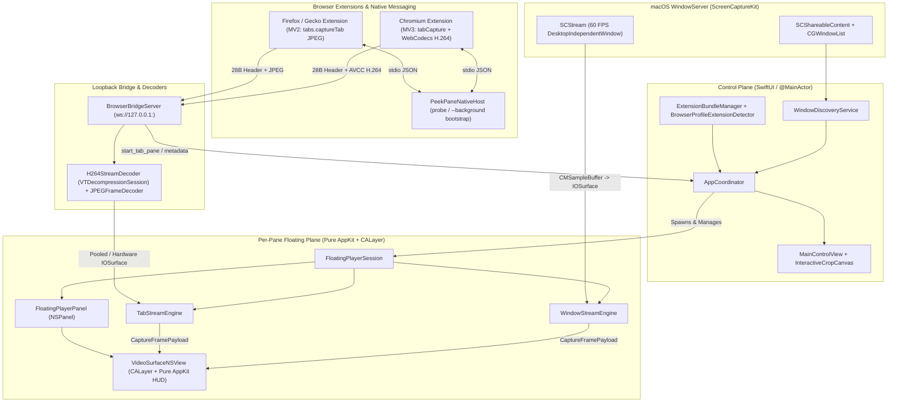

# PeekPane Architecture

This document details how **PeekPane 2.0** is architected, how frames flow from both macOS `WindowServer` (`ScreenCaptureKit`) and desktop web browsers (Chromium & Firefox/Gecko) into floating Picture-in-Picture panes with zero-copy `IOSurface` compositing, how crop/resize coordinate math works, and why specific AppKit, SwiftUI, and WebExtension boundaries were chosen.

---

## 1. High-Level System Overview

PeekPane uses a hybrid **SwiftUI + Pure AppKit** architecture backed by two pluggable capture pipelines unified under `CaptureStreamEngine`:

- **Control Plane (SwiftUI / `@MainActor`)**: The main window (`MainControlView`), 2×3 visual region preset grid, interactive preview cropper (`InteractiveCropCanvas`), guided browser setup sheets (`ExtensionSetupSheetView`), and Menu Bar extra (`PeekPaneApp`) are built with SwiftUI and coordinated by `AppCoordinator`.
- **Window Capture Pipeline (`ScreenCaptureKit`)**: Captures any native macOS window at 60 FPS directly from `WindowServer` via `SCStream` (`WindowStreamEngine`).
- **Browser Tab Pipeline (`Network.framework` + `VideoToolbox` / `ImageIO`)**: Receives background tab frames over an authenticated `127.0.0.1` WebSocket (`BrowserBridgeServer`) from Chromium (`WebCodecs` H.264 → `H264StreamDecoder`) and Firefox/Gecko (`tabs.captureTab` JPEG → `JPEGFrameDecoder`), fanned out to per-pane `TabStreamEngine` consumers.
- **Floating Rendering Plane (100% Pure AppKit + `CALayer`)**: Each floating pane (`FloatingPlayerPanel` + `VideoSurfaceNSView`) uses pure AppKit and `CALayer` with zero `NSHostingView` and zero Auto Layout constraints to guarantee crash-free interactive resizing and direct GPU `IOSurface` display.



---

## 2. Core Subsystems

### 2.1 Window Discovery & Z-Order Filtering (`WindowDiscoveryService.swift`)
Discovering real user windows on macOS requires combining two system APIs because neither provides the complete picture alone:
1. **`SCShareableContent.excludingDesktopWindows(true, onScreenWindowsOnly: false)`**:
   - Returns `SCWindow` handles required to initialize `SCContentFilter(desktopIndependentWindow:)`.
   - Includes windows across all Spaces as well as off-screen/auxiliary windows, and does **not** guarantee front-to-back visual Z-order.
2. **`CGWindowListCopyWindowInfo([.optionOnScreenOnly, .excludeDesktopElements], kCGNullWindowID)`**:
   - Returns visible windows in strict front-to-back visual stacking order.
   - Allows inspecting `kCGWindowAlpha` to discard invisible (`alpha <= 0.01`) overlay windows.

**Filtering Heuristics (`WindowDiscoveryService.refreshWindows`)**:
- Restricts to normal application window layer (`windowLayer == 0`) and minimum dimensions (`>= 80 × 60 pt`).
- Excludes PeekPane's own process ID (`ProcessInfo.processInfo.processIdentifier`) and system UI processes (`Dock`, `WindowServer`, `ControlCenter`, `SystemUIServer`, `NotificationCenter`, `Spotlight`, `Wallpaper`).
- Requires owning apps to have `NSApplication.ActivationPolicy.regular`.
- **Ghost/Dummy Window Elimination**: Many macOS apps (Finder, Chrome, Electron apps) keep hidden `500 × 500` off-screen backing windows or untitled off-screen helper windows. `WindowDiscoveryService` filters out untitled off-screen windows and off-screen windows matching exact `500 × 500` dummy dimensions, then sorts visible on-screen windows first by their true `CGWindowList` Z-order rank.

---

### 2.2 Zero-Copy 60 FPS Window Capture Engine (`WindowStreamEngine.swift`)
Each window-backed floating pane owns an isolated `WindowStreamEngine` bound to a single `SCWindow`:

1. **Window-Independent Capture (`SCContentFilter(desktopIndependentWindow:)`)**:
   - Captures the target window directly from its WindowServer backing store regardless of whether other windows overlap it on screen.
2. **Immediate Initial Frame (`SCScreenshotManager`)**:
   - `SCStream` only emits a `CMSampleBuffer` when the target window repaints or composites. For static windows, `WindowStreamEngine.captureInitialSnapshot()` immediately grabs a high-resolution `CGImage` via `SCScreenshotManager.captureImage` before the stream loop begins so the floating pane never opens blank.
3. **Retina Resolution Clamping (`makeStreamConfig`)**:
   - `SCStreamConfiguration` is configured for `2×` Retina pixel density (`window.frame.width * 2`, `window.frame.height * 2`).
   - Hardware video pipelines enforce a `3840 px` (4K) maximum dimension limit. If a window exceeds `3840 px` on either axis, `makeStreamConfig` scales `width` and `height` down **proportionally** so the aspect ratio of the captured `IOSurface` always matches the source window's point aspect ratio.
4. **Zero-Copy `IOSurface` Retention & Delivery**:
   - On the dedicated serial capture queue (`com.peekpane.stream.<windowID>`), `stream(_:didOutputSampleBuffer:of:)` extracts both the `CVPixelBuffer` (`CMSampleBufferGetImageBuffer`) and its underlying `IOSurfaceRef` (`CVPixelBufferGetIOSurface`), retaining both inside `CaptureFramePayload` so the backing buffer cannot be recycled mid-composite.
   - On `@MainActor`, `videoLayer.contents = payload.surface` hands the GPU surface directly to CoreAnimation without `CGImage` conversion or CPU pixel copies.
5. **Lifecycle & Closure Detection**:
   - Inspects `SCStreamFrameInfo.status` (`.complete`, `.idle`, `.blank`, `.suspended`, `.stopped`) and `SCStreamDelegate.stream(_:didStopWithError:)` to detect when the source window is minimized or closed, surfacing `ClosedSourceBannerView` with a one-click **Re-choose** menu.

---

### 2.3 Normalized Crop Geometry (`CaptureSessionModel.swift`)
All crop coordinates—across both native windows and browser tabs—are stored in a resolution-independent `NormalizedCropRect`:

$$\text{x}, \text{y} \in [0, 1], \quad \text{width}, \text{height} \in [0.042, 1.0], \quad (\text{origin} = \text{top-left})$$

- **Clamping (`clamped(minSize: 0.042)`)**: Ensures `width` and `height` are within `[0.042, 1.0]` and `x + width <= 1.0`, `y + height <= 1.0`.
- **Panning (`panned(dx:dy:)`)**: Translates `(x, y)` by normalized delta fractions and clamps against `[0, 1]` edges without changing `width` or `height`.
- **Aspect-Ratio-Locked Zoom (`zoomed(by:minSize:)`)**:
  - Computes the maximum permissible scale factor before *either* width or height reaches `1.0`:
    $$\text{maxScale} = \min\left(\frac{1.0}{\text{width}}, \frac{1.0}{\text{height}}\right)$$
  - Computes the minimum permissible scale factor before *either* dimension hits `minSize`:
    $$\text{minScale} = \max\left(\frac{\text{minSize}}{\text{width}}, \frac{\text{minSize}}{\text{height}}\right)$$
  - Clamping `scaleFactor` to `[\text{minScale}, \text{maxScale}]` before scaling both `width` and `height` uniformly around the crop center prevents aspect-ratio distortion when zooming all the way out or in.

---

### 2.4 Pure AppKit Floating Pane & Display-Cycle Safety (`FloatingPlayerPanel.swift`, `VideoSurfaceNSView.swift`, `FloatingPlayerHUDViews.swift`)

#### Why Zero `NSHostingView` and Zero Auto Layout?
On macOS 26 (`SwiftUI 7.6+`), hosting a rapidly resized borderless `NSPanel`'s root view inside `NSHostingView` causes `NSHostingView.windowDidLayout()` to invoke `NSHostingView.updateAnimatedWindowSize(_:)` → `NSHostingView.invalidateSafeAreaCornerInsets()` → `-[NSView setNeedsUpdateConstraints:]` while `-[NSWindow layoutIfNeeded]` is currently executing on the display cycle. AppKit strictly forbids posting constraint updates during `layoutIfNeeded` and aborts with `SIGABRT` in `-[NSWindow(NSDisplayCycle) _postWindowNeedsUpdateConstraints]`.

To eliminate this class of bug completely:
- `FloatingPlayerPanel`'s `contentView` is `VideoSurfaceNSView`, a pure AppKit `NSView`.
- All HUD controls inside `VideoSurfaceNSView` are pure custom `NSView` / `NSVisualEffectView` subclasses with **zero `NSHostingView`**, **zero `NSControl` (`NSSlider`, `NSButton`, `NSTextField`)**, and **zero Auto Layout constraints**:
  - `FloatingHUDTopBarView`: Translucent `.hudWindow` pill housing the 4 icon buttons and opacity slider.
  - `HUDCircleButton`: Custom CoreGraphics circular icon button rendering SF Symbols and the custom vector ghost outline (`GhostIconRenderer`).
  - `HUDOpacitySlider`: Custom CoreGraphics continuous slider (`0.2` – `1.0`).
  - `HUDGoToAppButton`: Bottom-right translucent `.hudWindow` action pill (`Go`) that raises/activates the captured source window or browser tab.
  - `PassthroughVisualEffectPill`: Non-hit-testing (`hitTest -> nil`) helper pill shown during Crop Mode.
  - `ClosedSourceBannerView` & `HUDTextPillButton`: Shown when the target window or browser tab closes.
- Every view updates its geometry synchronously inside `setFrameSize(_:)` with `CATransaction.setDisableActions(true)`, leaving zero deferred layout or constraint passes for the display cycle.

#### Sub-Region & Un-Letterboxed Rendering via `CALayer` Geometry
`VideoSurfaceNSView` overrides `isFlipped = true` (so `(0, 0)` is top-left, matching `NormalizedCropRect`) and sets `layer?.masksToBounds = true`. First, `NormalizedCropRect` is projected into `activeContentNormalizedRect` (which is `(0, 0, 1, 1)` for `SCStream` and Gecko snapshots, or the un-letterboxed sub-rect when Chromium `tabCapture` pads a resized viewport):

```swift
let effX = activeRect.origin.x + c.x * activeRect.width
let effY = activeRect.origin.y + c.y * activeRect.height
let effW = max(0.005, c.width * activeRect.width)
let effH = max(0.005, c.height * activeRect.height)

let fullW = viewW / effW
let fullH = viewH / effH
videoLayer.frame = CGRect(
    x: -effX * fullW,
    y: -effY * fullH,
    width: fullW,
    height: fullH
)
```

Because `VideoSurfaceNSView` clips to its `bounds`, positioning `videoLayer` at `(-effX * fullW, -effY * fullH)` with size `(fullW, fullH)` displays the exact target sub-region across the floating pane with zero texture reallocation.

#### Dual-Mode Interactive 8-Way Resizing
`VideoSurfaceNSView` implements custom hit-testing (`edgeHitThickness = 14pt`, `cornerHitSize = 22pt`) and custom diagonal/cardinal resize cursors across all 4 edges and 4 corners. Dragging an edge or corner delegates screen-space mouse deltas `(dx, dy)` to `FloatingPlayerSession.updateInteractiveResize(edge:dx:dy:)`, which operates in one of two modes:


1. **Normal Mode (`isAdjustingCrop == false`)**:
   - Computes `aspect = initialFrame.width / initialFrame.height` and scales the window frame proportionally while keeping `cropRect` constant.
2. **Crop Mode (`isAdjustingCrop == true`)**:
   - Computes the virtual full source window/tab frame in screen space from `initialFrame` and `initialCrop`.
   - Moving any edge or corner moves that edge in screen space (clamped between `168 × 98 pt` minimum panel size and the virtual source bounds) and recomputes `cropRect` as the new window frame's normalized projection inside the virtual full source.

---

### 2.5 Ghost Mode (Click-Through) & `⌥ Option` Override
When `session.isClickThrough` is enabled:
- `panel.ignoresMouseEvents` is set to `true`, causing macOS WindowServer to route all mouse clicks and scroll events directly to the application windows behind the floating pane.
- `FloatingPlayerSession` registers both global (`NSEvent.addGlobalMonitorForEvents(matching: .flagsChanged)`) and local (`NSEvent.addLocalMonitorForEvents(matching: .flagsChanged)`) monitors for the `⌥ Option` modifier key.
- Effective mouse ignore state is computed as:
  ```swift
  panel?.ignoresMouseEvents = isClickThrough && !isOptionKeyPressed
  ```
- Holding `⌥ Option` immediately restores mouse interactivity and reveals the HUD on hover so the user can toggle Ghost Mode off or move/resize the pane, and releasing `⌥ Option` resumes click-through. Users can also disable Ghost Mode across all panes at any time from the macOS Menu Bar.

---

### 2.6 App Switcher (`⌘ + Tab`) & Window Switcher Isolation
PeekPane ensures active floating panes never clutter `⌘ + Tab`, third-party window switchers (`AltTab`), Mission Control, or `⌘ + ~` window cycling:
- **Dynamic Activation Policy (`AppDelegate`)**: While the main control window is open (or minimized in the Dock), `NSApp` runs with `.regular` activation policy. As soon as the main control window is closed—or when cold-launched via `--background` by `PeekPaneNativeHost`—`AppDelegate` runs `NSApp` in `.accessory` policy with zero standard windows while keeping all `FloatingPlayerPanel` windows ordered front. Reopening the main window from the Menu Bar or Spotlight (`applicationShouldHandleReopen`) instantiates/orders the managed `NSWindow` and restores `.regular` policy.
- **Floating Panel Window Semantics (`FloatingPlayerPanel`)**: Configured with `[.borderless, .nonactivatingPanel]`, `collectionBehavior = [.canJoinAllSpaces, .transient, .ignoresCycle, .fullScreenAuxiliary]`, `isExcludedFromWindowsMenu = true`, `canBecomeKey = false`, and `setAccessibilitySubrole(.floatingWindow)` (`AXFloatingWindow`) so individual floating panes are ignored by window switchers, Mission Control, and keyboard window cycling without stealing focus from underlying apps.

---

### 2.7 Browser Tab Direct Extraction Pipeline (`Extension/`, `FirefoxExtension/`, `PeekPaneNativeHost`, `BrowserBridgeServer`, `H264StreamDecoder`, `JPEGFrameDecoder`, `TabStreamEngine`)

PeekPane supports direct background tab extraction across **12 macOS browsers** spanning two engine families—without requiring macOS Screen Recording TCC permission:
- **Chromium Family**: Google Chrome, Arc, Brave, Microsoft Edge, Vivaldi, and Chromium (`Extension/`).
- **Gecko Family**: Firefox, Firefox Developer Edition, Zen Browser, LibreWolf, Floorp, and Waterfox (`FirefoxExtension/`).

#### 1. Engine-Specific Capture & Why Gecko Uses Manifest V2
- **Chromium (`Extension/`, Manifest V3)**:
  - On toolbar click or `⌥⇧P`, `service-worker.js` synchronously invokes `chrome.tabCapture.getMediaStreamId({ targetTabId })` before any `await` to preserve the transient `activeTab` user gesture, then passes the single-use stream ID to an MV3 Offscreen Document (`offscreen.js`).
  - `offscreen.js` pipes `MediaStreamTrackProcessor` frames into hardware `WebCodecs` `VideoEncoder` (`avc1.4D4032` / `avc1.4D4033`, Main Profile L5.0/L5.1 in `avc` / AVCC mode at ~24 FPS), retaining `lastRawFrame` + `ImageCapture.grabFrame()` fallback so static pages emit immediate keyframes on demand.
- **Firefox & Gecko Forks (`FirefoxExtension/`, Manifest V2 Persistent Background Page)**:
  - Gecko does not implement `chrome.tabCapture` or Offscreen Documents, so `background.js` captures tabs via `browser.tabs.captureTab(tabId, { format: 'jpeg', quality: 78, scale })` (~14 FPS active interval, backing off to ~5.5 FPS when 5 consecutive frames match `dataUrl === lastDataUrl`, with fast `Uint8Array.fromBase64` decoding).
  - **Architectural Choice — Manifest V2 over MV3 on Gecko**: Mozilla officially supports Manifest V2 alongside MV3 without deprecation. Using MV2 (`"manifest_version": 2`, `"persistent": true`) solves three critical Gecko-specific runtime issues:
    1. **Loopback `ws://` CSP Compatibility**: Gecko's built-in MV3 default CSP (`extensions.webextensions.default-content-security-policy.v3`) injects `upgrade-insecure-requests;`, which silently upgrades `new WebSocket("ws://127.0.0.1:<port>")` to TLS `wss://` and breaks plain loopback sockets; MV2's default CSP omits `upgrade-insecure-requests`.
    2. **Continuous Connection Presence**: Gecko MV3 terminates background event pages after ~30 seconds of idle, which would drop `controlWs` and mark temporary `about:debugging` add-ons as disconnected in PeekPane; MV2 `"persistent": true` keeps `controlWs` continuously connected with fast reconnect retries (`1.5s`, `3s`, `6s`).
    3. **Upfront `<all_urls>` Grant**: Declaring `"<all_urls>"` in MV2 `"permissions"` avoids MV3 runtime `permissions.request` doorhangers that fail to anchor in custom sidebar UIs such as Zen Browser.
- **Shared In-Page Crop Overlay (`crop-overlay.js`)**:
  - Both extensions inject an isolated closed Shadow DOM overlay supporting element hover-snapping (`VIDEO`, `CANVAS`, `IFRAME`, `IMG`, `SVG`, `FIGURE`, `ARTICLE`, `SECTION`, `ASIDE`, `TABLE`), freehand drag selection, `Enter` / **Float Full Tab**, and a 2-`requestAnimationFrame` + 80 ms settle delay before the first frame is captured so the selection HUD never appears in the stream. If script injection is blocked (e.g., built-in PDF viewer or raw media tabs), both extensions automatically fall back to floating the full tab viewport.

#### 2. Native Messaging Bootstrap, Profile Detection & Loopback Security
- **Staging & Manifest Registration (`ExtensionBundleManager`)**:
  - On launch, `ExtensionBundleManager` atomically stages `Extension/` and `FirefoxExtension/` into `~/Library/Application Support/PeekPane/` and writes `com.peekpane.bridge.json` into installed Chromium (`allowed_origins: ["chrome-extension://noibghleoblgaecnekfpbfngfgjolhab/"]`) and Gecko (`allowed_extensions: ["bridge@peekpane.app"]` across `Mozilla`, `zen`, `LibreWolf`, `Floorp`, `Waterfox`) `NativeMessagingHosts` directories.
- **Accurate Extension Presence (`BrowserProfileExtensionDetector`)**:
  - Rather than storing sticky flags in `UserDefaults`, PeekPane combines live WebSocket presence (`bridgeServer.isCurrentlyConnected(for:)`) with read-only profile inspection on disk: parsing Chromium `Secure Preferences` / `Preferences` (`extensions.settings.<pinnedID>` active state, `disable_reasons`, and unpacked path existence) and Gecko `extensions.json` (`addons` entry for `bridge@peekpane.app` with `active && !userDisabled`).
- **Two-Mode Native Host (`PeekPaneNativeHost`)**:
  - `probe` reads `~/Library/Application Support/PeekPane/bridge-endpoint.json` (`0600` permissions), verifies `kill(pid, 0) == 0` and non-blocking TCP reachability on `127.0.0.1:<wsPort>`, and resolves the outermost calling `.app` bundle identifier via `getppid()` + `proc_pidpath` (walking past nested helpers such as Gecko's `plugin-container.app`) **without** launching PeekPane.
  - `bootstrap` (invoked only on explicit user action in the browser) cold-launches `PeekPane.app` (or `PeekPaneDev.app`) with `--args --background` and `activates = false`, polling up to 10 s for `bridge-endpoint.json`.
- **Loopback WebSocket Authentication (`BrowserBridgeServer`, `BridgeSecurity`)**:
  - Binds strictly to `127.0.0.1:0` (`NWParameters(tls: nil, tcp: tcpOptions)` with `TCP_NODELAY`).
  - During the HTTP WebSocket upgrade handshake, `NWProtocolWebSocket.Options.setClientRequestHandler` rejects any connection whose `Origin` header does not match `BridgeSecurity.isAllowedExtensionOrigin` (either exact pinned `chrome-extension://noibghleoblgaecnekfpbfngfgjolhab` or strict 36-char hex UUID `moz-extension://<uuid>`), preventing arbitrary websites or local scripts without the token from opening a socket.
  - Requires a `hello` frame within 5 s carrying the 256-bit random hex `authToken` verified via `BridgeSecurity.constantTimeEquals`.

#### 3. 28-Byte Binary Wire Framing & Unified Hardware/Pooled Decoding
Every binary frame sent over the `stream` WebSocket begins with a 28-byte big-endian `BridgeWireHeader` (`PeekPaneBridgeWire`):

| Byte Offset | Size | Field | Description |
| :--- | :--- | :--- | :--- |
| `0..1` | `2 B` | `magic` | `0x50 0x50` (`"PP"`) |
| `2` | `1 B` | `version` | Protocol version (`0x01`) |
| `3` | `1 B` | `flags` | Bit `0` (`0x01`): keyframe; Bit `1` (`0x02`): has `avcC`; Bit `2` (`0x04`): JPEG payload |
| `4..7` | `4 B` | `tabID` | Browser tab identifier (`UInt32` BE) |
| `8..11` | `4 B` | `sequenceNumber` | Per-tab monotonic packet counter (`UInt32` BE) |
| `12..19` | `8 B` | `timestampUs` | Monotonic presentation timestamp in microseconds (`UInt64` BE) |
| `20..21` | `2 B` | `viewportWidth` | Live CSS viewport width in points (`UInt16` BE) |
| `22..23` | `2 B` | `viewportHeight` | Live CSS viewport height in points (`UInt16` BE) |
| `24..25` | `2 B` | `avcCLength` | Byte length of following ISO `14496-15` `avcC` record (`0` for delta/JPEG) |
| `26..27` | `2 B` | `reserved` | Zero-padded reserved bytes |

- **Chromium H.264 Path (`H264StreamDecoder`)**: Parses `avcC` SPS/PPS parameter sets (`AVCCParser`), checks `VTDecompressionSessionCanAcceptFormatDescription` across dynamic resizes without tearing down the hardware session when compatible, enforces `sequenceNumber` continuity (dropping P-frames after a gap and issuing `request_keyframe`), and decodes into Metal-compatible, `IOSurface`-backed `32BGRA` `CVPixelBuffer` frames.
- **Gecko JPEG Path (`JPEGFrameDecoder`)**: Triggered when `header.isJPEGFrame` (`0x04`) is set; decodes JPEG bytes via `ImageIO` (`kCGImageSourceShouldCache: false`) directly into a `CVPixelBufferPool` of `IOSurface`-backed `32BGRA` buffers reused across frames.
- **Multiplexing & Frame Coalescing (`SharedTabStream` + `TabStreamEngine`)**: Multiple floating panes cropping different regions of the same browser tab share a single `SharedTabStream` and decoder instance in `BrowserBridgeServer`, while each pane's `TabStreamEngine` coalesces rapid bursts via `OSAllocatedUnfairLock` so `@MainActor` never queues stale frames.

---

### 2.8 Side-by-Side Dev vs. Production Build Identity (`build_app.sh`, `AppBuildIdentity`)

To allow iterating on local source builds without overwriting `/Applications/PeekPane.app`, corrupting macOS TCC permissions, or mixing `NSWindow` autosave state:
- **Local Default (`./build_app.sh`, `make app`, `make install`)**: Produces `PeekPaneDev.app` with bundle ID `com.peekpane.app.dev`, helper ID `com.peekpane.app.dev.native-host`, `PPIsDevBuild = true` in `Info.plist`, separate `PeekPaneDevMainWindow` frame autosave key, a toolbar `DEV` capsule badge (`DevBuildBadgeView`), and a top-right template knockout dot in `MenuBarIconRenderer`.
- **Squircle-Safe Dev App Icon (`build_app.sh`)**: On macOS 26 Tahoe, `IconServices` inspects `.icns` alpha silhouettes and shrinks any icon with pixels extending outside Apple's standard `832 × 832` (`rx = 190`) squircle bounds onto a white backing plate. `build_app.sh` clips `PeekPaneDev`'s amber `DEV` corner ribbon strictly inside `NSRect(x: 98, y: 98, width: 828, height: 828)` (`rx = 188`), preserving the native full-bleed Liquid Glass icon silhouette.
- **Production Release (`./build_app.sh --release`, `make prod-app`, `make release`)**: Produces clean `PeekPane.app` (`com.peekpane.app`, `PPIsDevBuild = false`) with unbadged icons and titles.
