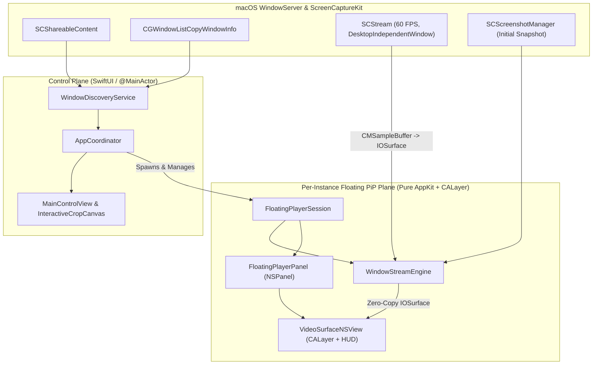
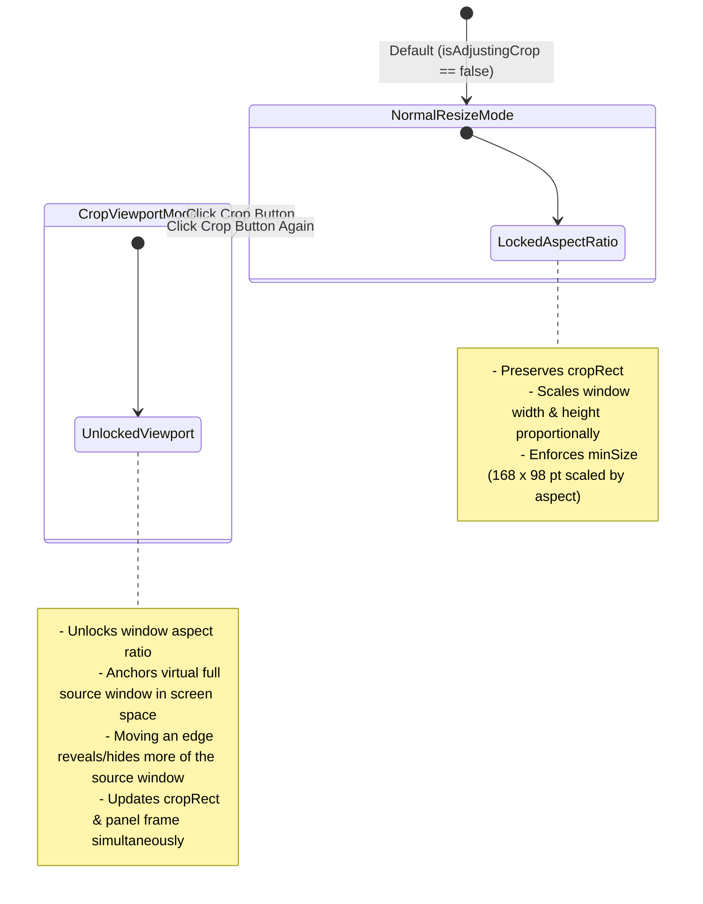

# PeekPane Architecture

This document details how **PeekPane** is architected, how frames flow from macOS `WindowServer` to the floating Picture-in-Picture window with zero CPU pixel copies, how crop/resize coordinate math works, and why specific AppKit vs. SwiftUI boundaries were chosen.

---

## 1. High-Level System Overview

PeekPane uses a hybrid **SwiftUI + Pure AppKit** architecture:
- **Control Plane (SwiftUI)**: The main window (`MainControlView`), interactive preview cropper (`InteractiveCropCanvas`), and Menu Bar extra (`PeekPaneApp`) are built with SwiftUI and coordinated by a `@MainActor` state container (`AppCoordinator`).
- **Data & Rendering Plane (Pure AppKit + CoreAnimation + ScreenCaptureKit)**: Each floating PiP window (`FloatingPlayerPanel`) and its entire view/layer subtree (`VideoSurfaceNSView`) are built with **100% pure AppKit and `CALayer`**—with zero `NSHostingView` and zero Auto Layout constraints—to guarantee crash-free, 60 FPS interactive resizing and zero-copy `IOSurface` rendering.



---

## 2. Core Subsystems

### 2.1 Window Discovery & Z-Order Filtering (`WindowDiscoveryService.swift`)
Discovering real user windows on macOS requires combining two system APIs because neither provides the complete picture alone:
1. **`SCShareableContent.excludingDesktopWindows(true, onScreenWindowsOnly: false)`**:
   - Returns `SCWindow` handles required to initialize `SCContentFilter(desktopIndependentWindow:)`.
   - Includes windows across all Spaces as well as off-screen/auxiliary windows, and does **not** guarantee front-to-back visual Z-order.
2. **`CGWindowListCopyWindowInfo([.optionOnScreenOnly, .excludeDesktopElements], kCGNullWindowID)`**:
   - Returns visible windows in strict front-to-back visual stacking order.
   - Allows inspecting `kCGWindowAlpha` to discard invisible (`alpha <= 0.01`) overlay windows.

**Filtering Heuristics (`WindowDiscoveryService.refreshWindows`)**:
- Restricts to normal application window layer (`windowLayer == 0`) and minimum dimensions (`>= 80 × 60 pt`).
- Excludes PeekPane's own process ID (`ProcessInfo.processInfo.processIdentifier`) and system UI processes (`Dock`, `WindowServer`, `ControlCenter`, `SystemUIServer`, `NotificationCenter`, `Spotlight`, `Wallpaper`).
- Requires owning apps to have `NSApplication.ActivationPolicy.regular`.
- **Ghost/Dummy Window Elimination**: Many macOS apps (Finder, Chrome, Electron apps) keep hidden `500 × 500` off-screen backing windows or untitled off-screen helper windows. `WindowDiscoveryService` filters out untitled off-screen windows and off-screen windows matching exact `500 × 500` dummy dimensions, then sorts visible on-screen windows first by their true `CGWindowList` Z-order rank.

---

### 2.2 Zero-Copy 60 FPS Capture Engine (`WindowStreamEngine.swift`)
Each floating player owns an isolated `WindowStreamEngine` instance bound to a single `SCWindow`:

1. **Window-Independent Capture (`SCContentFilter(desktopIndependentWindow:)`)**:
   - Captures the target window directly from its WindowServer backing store regardless of whether other windows overlap it on screen.
2. **Immediate Initial Frame (`SCScreenshotManager`)**:
   - `SCStream` only emits a `CMSampleBuffer` when the target window repaints or composites. For static windows, `WindowStreamEngine.captureInitialSnapshot()` immediately grabs a high-resolution `CGImage` via `SCScreenshotManager.captureImage` before the stream loop begins so the floating player never opens blank.
3. **Retina Resolution Clamping (`makeStreamConfig`)**:
   - `SCStreamConfiguration` is configured for `2×` Retina pixel density (`window.frame.width * 2`, `window.frame.height * 2`).
   - Hardware video encoders enforce a `3840 px` (4K) maximum dimension limit. If a window exceeds `3840 px` on either axis, `makeStreamConfig` scales `width` and `height` down **proportionally** so the aspect ratio of the captured `IOSurface` always matches the source window's point aspect ratio.
4. **Zero-Copy `IOSurface` Extraction**:
   - On the dedicated serial capture queue (`com.peekpane.stream.<windowID>`), `stream(_:didOutputSampleBuffer:of:)` extracts the `CVPixelBuffer` (`CMSampleBufferGetImageBuffer`) and its underlying `IOSurfaceRef` (`CVPixelBufferGetIOSurface`).
   - The `IOSurface` (cast to `AnyObject`) is dispatched to `@MainActor` and assigned directly to `videoLayer.contents = payload.surface`. CoreAnimation composites the GPU surface directly without converting to `CGImage` or copying pixels through CPU memory.
5. **Lifecycle & Closure Detection**:
   - Inspects `SCStreamFrameInfo.status` (`.complete`, `.idle`, `.blank`, `.suspended`, `.stopped`) and `SCStreamDelegate.stream(_:didStopWithError:)` to detect when the source window is minimized or closed, surfacing a `ClosedSourceBannerView` with a one-click **Re-choose** action.

---

### 2.3 Normalized Crop Geometry (`CaptureSessionModel.swift`)
All crop coordinates are stored in a resolution-independent `NormalizedCropRect`:

$$\text{x}, \text{y} \in [0, 1], \quad \text{width}, \text{height} \in [0.042, 1.0], \quad (\text{origin} = \text{top-left})$$

- **Clamping (`clamped(minSize: 0.042)`)**: Ensures `width` and `height` are within `[0.042, 1.0]` and `x + width <= 1.0`, `y + height <= 1.0`.
- **Panning (`panned(dx:dy:)`)**: Translates `(x, y)` by normalized delta fractions and clamps against `[0, 1]` edges without changing `width` or `height`.
- **Aspect-Ratio-Locked Zoom (`zoomed(by:minSize:)`)**:
  - Computes the maximum permissible scale factor before *either* width or height reaches `1.0`:
    $$\text{maxScale} = \min\left(\frac{1.0}{\text{width}}, \frac{1.0}{\text{height}}\right)$$
  - Computes the minimum permissible scale factor before *either* dimension hits `minSize`:
    $$\text{minScale} = \max\left(\frac{\text{minSize}}{\text{width}}, \frac{\text{minSize}}{\text{height}}\right)$$
  - Clamping `scaleFactor` to `[\text{minScale}, \text{maxScale}]` before scaling both `width` and `height` uniformly around the crop center prevents aspect-ratio distortion when zooming all the way out or in.

---

### 2.4 Pure AppKit Floating Player & Display-Cycle Safety (`FloatingPlayerPanel.swift`)

#### Why Zero `NSHostingView` and Zero Auto Layout?
On macOS 26 (`SwiftUI 7.6+`), hosting a rapidly resized borderless `NSPanel`'s root view inside `NSHostingView` causes `NSHostingView.windowDidLayout()` to invoke `NSHostingView.updateAnimatedWindowSize(_:)` → `NSHostingView.invalidateSafeAreaCornerInsets()` → `-[NSView setNeedsUpdateConstraints:]` while `-[NSWindow layoutIfNeeded]` is currently executing on the display cycle. AppKit strictly forbids posting constraint updates during `layoutIfNeeded` and aborts with `SIGABRT` in `-[NSWindow(NSDisplayCycle) _postWindowNeedsUpdateConstraints]`.

To eliminate this class of bug completely:
- `FloatingPlayerPanel`'s `contentView` is `VideoSurfaceNSView`, a pure AppKit `NSView`.
- All HUD controls inside `VideoSurfaceNSView` are pure custom `NSView` / `NSVisualEffectView` subclasses with **zero `NSHostingView`**, **zero `NSControl` (`NSSlider`, `NSButton`, `NSTextField`)**, and **zero Auto Layout constraints**:
  - `FloatingHUDTopBarView`: Translucent `.hudWindow` pill housing the 4 icon buttons and opacity slider.
  - `HUDCircleButton`: Custom CoreGraphics circular icon button rendering SF Symbols and the custom vector ghost outline (`GhostIconRenderer`).
  - `HUDOpacitySlider`: Custom CoreGraphics continuous slider (`0.2` – `1.0`).
  - `HUDGoToAppButton`: Bottom-right translucent `.hudWindow` action pill (`Go`) that raises and focuses the specific captured source window.
  - `PassthroughVisualEffectPill`: Non-hit-testing (`hitTest -> nil`) helper pill shown during Crop Mode.
  - `ClosedSourceBannerView` & `HUDTextPillButton`: Shown when the target window closes.
- Every view updates its geometry synchronously inside `setFrameSize(_:)` with `CATransaction.setDisableActions(true)`, leaving zero deferred layout or constraint passes for the display cycle.

#### Sub-Region Rendering via `CALayer` Geometry
`VideoSurfaceNSView` overrides `isFlipped = true` (so `(0, 0)` is top-left, matching `NormalizedCropRect`) and sets `layer?.masksToBounds = true`. Given viewport size `(viewW, viewH)` and crop rect `(c.x, c.y, c.width, c.height)`:

```swift
let fullW = viewW / c.width
let fullH = viewH / c.height
videoLayer.frame = CGRect(
    x: -c.x * fullW,
    y: -c.y * fullH,
    width: fullW,
    height: fullH
)
```

Because `VideoSurfaceNSView` clips to its `bounds`, positioning `videoLayer` at `(-c.x * fullW, -c.y * fullH)` with size `(fullW, fullH)` displays the exact `[c.x ... c.x + c.width] × [c.y ... c.y + c.height]` sub-region across the floating window with zero texture reallocation.

#### Dual-Mode Interactive 8-Way Resizing
`VideoSurfaceNSView` implements custom hit-testing (`edgeHitThickness = 14pt`, `cornerHitSize = 22pt`) and custom diagonal/cardinal resize cursors across all 4 edges and 4 corners. Dragging an edge or corner delegates screen-space mouse deltas `(dx, dy)` to `FloatingPlayerSession.updateInteractiveResize(edge:dx:dy:)`, which operates in one of two modes:



1. **Normal Mode (`isAdjustingCrop == false`)**:
   - Computes `aspect = initialFrame.width / initialFrame.height` and scales the window frame proportionally while keeping `cropRect` constant.
2. **Crop Mode (`isAdjustingCrop == true`)**:
   - Computes the virtual full source window frame in screen space from `initialFrame` and `initialCrop`.
   - Moving any edge or corner moves that edge in screen space (clamped between `168 × 98 pt` minimum panel size and the virtual source window bounds) and recomputes `cropRect` as the new window frame's normalized projection inside the virtual full window. This lets you expand or shrink the crop viewport in place without stretching or shifting the underlying video.

---

### 2.5 Ghost Mode (Click-Through) & `⌥ Option` Override
When `session.isClickThrough` is enabled:
- `panel.ignoresMouseEvents` is set to `true`, causing macOS WindowServer to route all mouse clicks and scroll events directly to the application windows behind the floating player.
- `FloatingPlayerSession` registers both global (`NSEvent.addGlobalMonitorForEvents(matching: .flagsChanged)`) and local (`NSEvent.addLocalMonitorForEvents(matching: .flagsChanged)`) monitors for the `⌥ Option` modifier key.
- Effective mouse ignore state is computed as:
  ```swift
  panel?.ignoresMouseEvents = isClickThrough && !isOptionKeyPressed
  ```
- Holding `⌥ Option` immediately restores mouse interactivity and reveals the HUD on hover so the user can toggle Ghost Mode off or move/resize the player, and releasing `⌥ Option` resumes click-through. Users can also disable Ghost Mode across all players at any time from the macOS Menu Bar.

---

### 2.6 App Switcher (`⌘ + Tab`) & Window Switcher Isolation
PeekPane ensures active floating panes never clutter `⌘ + Tab`, third-party window switchers (`AltTab`), Mission Control, or `⌘ + ~` window cycling:
- **Dynamic Activation Policy (`AppDelegate`)**: While the main control window is open (or minimized in the Dock), `NSApp` runs with `.regular` activation policy. As soon as the main control window is closed, `AppDelegate` transitions `NSApp` to `.accessory` while keeping all `FloatingPlayerPanel` windows ordered front—removing PeekPane from `⌘ + Tab` and the Dock while floating panes and the Menu Bar item continue running. Reopening the main window from the Menu Bar or Spotlight (`applicationShouldHandleReopen`) restores `.regular` policy and brings the window to focus.
- **Floating Panel Window Semantics (`FloatingPlayerPanel`)**: Configured with `[.borderless, .nonactivatingPanel]`, `collectionBehavior = [.canJoinAllSpaces, .transient, .ignoresCycle, .fullScreenAuxiliary]`, `isExcludedFromWindowsMenu = true`, `canBecomeKey = false`, and `setAccessibilitySubrole(.floatingWindow)` (`AXFloatingWindow`) so individual floating panes are ignored by window switchers, Mission Control, and keyboard window cycling without stealing focus from underlying apps.
