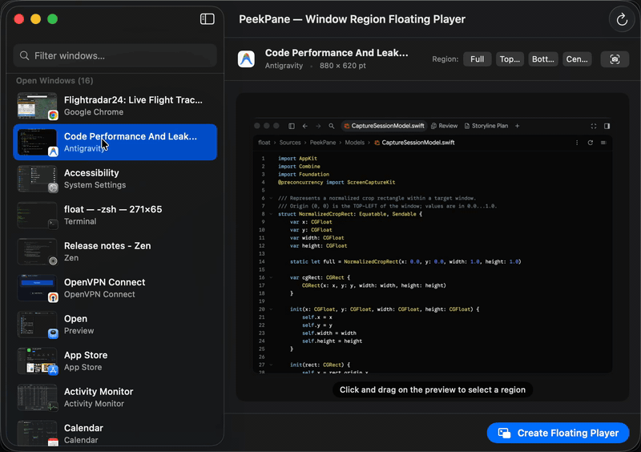
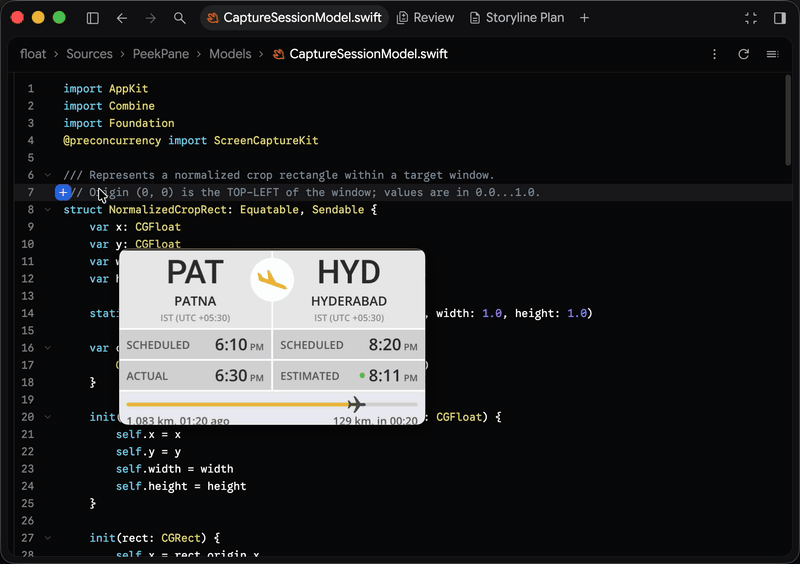
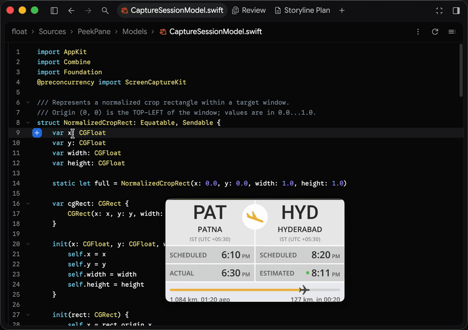
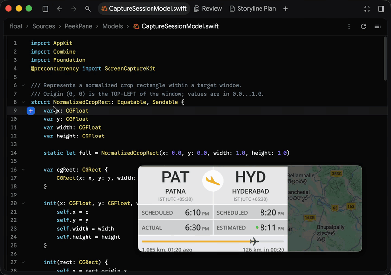

<p align="center">
  
</p>

<h1 align="center">PeekPane</h1>

<p align="center">
  <strong>Turn any slice of any Mac window into a live, always-on-top, click-through floating pane.</strong><br/>
  Crop a flight progress bar, stock ticker, live sports score, delivery map, or terminal log—and keep just that compact region floating at 60 FPS while you work.
</p>

<p align="center">
  <a href="https://github.com/rituraj22/PeekPane/releases/latest"></a>
  
  
  <a href="./LICENSE"></a>
</p>

<p align="center">
  
</p>

---

## 💡 Why PeekPane?

Most macOS apps force an all-or-nothing choice: either dedicate half your screen to an entire browser or app window, or bury it behind your active workspace and constantly `⌘ Tab` back to check it.

**PeekPane** lets you **slice out only the compact region you actually care about**—like a `PAT ✈ HYD` flight progress bar on Flightradar24, a single TradingView candle chart, a live match score, or a CI build log—and float it anywhere on your screen at **60 FPS**. Even when the source window is completely covered by your IDE or other apps, your floating pane stays live.

---

## 🎬 Live Walkthrough: Tracking a Flight While Coding in Antigravity

Suppose you are tracking a live flight (**IndiGo `IGO6127`** on [Flightradar24](https://www.flightradar24.com/IGO6127/42835550)) in **Google Chrome** while writing Swift code in **Antigravity**. Instead of keeping the full browser window open, here is how **PeekPane** keeps just the live progress bar in view without ever blocking your editor:

### 1. ✂️ Cut Out the Clutter — Select, Crop & Float
Pick any open window from the **PeekPane** sidebar and drag the 8-handle crop box tightly around the exact strip you want—here, just the **`PAT ✈ HYD` schedule & yellow flight progress bar**. Click **Create Floating Player** and switch back to your code editor.

<p align="center">
  
</p>

---

### 2. 👻 Ghost Mode & Custom Transparency — Work Right Underneath the Overlay
Normally, a floating window covers up whatever code or UI buttons sit behind it. **Ghost Mode** solves this by turning your floating pane into a **see-through, click-through overlay**:

1. **Dial in Custom Transparency (`20%` – `100%`)**: Drag the top HUD slider so you can clearly see both your live flight bar and the Swift code behind it.
2. **Click, Select Text & Scroll Right Through It**: Click the **Ghost icon** (`👻`) on the HUD. Your mouse now passes straight through the floating pane—you can **select code, type, trigger inline actions, and scroll** in the editor directly behind the overlay.
3. **Hold `⌥ Option` Anytime to Grab & Move (`✋`)**: Need to reposition a Ghost Mode pane? Hold **`⌥ Option`** while hovering over it—your pointer switches to a **Grab Hand (`✋`)** so you can smoothly drag, resize, or toggle Ghost Mode off without triggering macOS window-tiling snap.

<p align="center">
  
</p>

---

### 3. 🎛️ Live In-Place Crop Adjustment — Reveal More Without Starting Over
Want to peek at the live radar map right next to the `PAT ✈ HYD` status card without returning to the main window?
* Hover over the floating pane and click the **Crop (`crop`)** button in the top HUD (the border highlights in blue).
* **Drag any edge or corner** of the floating pane outward to **reveal more of the underlying window in place** (or drag inside to pan and scroll to zoom) without stretching the image.
* Click **Crop** again to lock the new region.

<p align="center">
  
</p>

---

### 4. ↗️ One-Click `↗ Go` to Source Window
When the flight lands—or whenever you want to interact with the full source window—hover over the floating pane and click the **`↗ Go`** pill in the bottom-right corner. **PeekPane** immediately raises and focuses that exact source window, even if the app has multiple windows open across displays.

<p align="center">
  
</p>

---

## 🎯 Everyday Use Cases

| Use Case | What You Can Float |
| :--- | :--- |
| **✈️ Flight, Ride & Delivery Trackers** | Float just the live progress bar, ETA strip, or courier map from Flightradar24, Uber, DoorDash, or Swiggy/Zomato until arrival. |
| **📈 Stocks, Crypto & Financial Tickers** | Crop a single TradingView candle chart, Apple Stocks watchlist row, order book, or portfolio balance and pin it to the corner while you work. |
| **⚽ Live Sports Scores & Timers** | Float just the live scoreboard, cricket/football ticker, or F1 timing tower from a browser window without keeping a cluttered webpage open. |
| **🛠️ Terminal Logs, CI/CD & Metrics** | Watch a running build, `docker compose` log, GitHub Actions workflow, or Grafana graph with **Ghost Mode** enabled so clicks pass right through it. |
| **🎥 Videos, Streams & Calls Without PiP** | Give any video player, Twitch/YouTube live chat, Zoom/Meet participant tile, or security camera feed a custom-cropped Picture-in-Picture window. |
| **🎨 Design References & Live Previews** | Float a cropped Figma component, UI spec, or localhost preview right beside (or translucently over) your IDE. |
| **🧩 Mini-Widgets from Native Mac Apps** | Turn a slice of Notes, Calendar, Weather, Activity Monitor, or Reminders into a compact, always-visible desktop widget. |

---

## 🕹️ Floating Pane Controls at a Glance

Hover over any floating pane to reveal its HUD controls:

| Control | Location | What It Does |
| :--- | :--- | :--- |
| **Switch Window** (`arrow.triangle.2.circlepath`) | Top HUD | Opens a live menu of all open windows to switch the pane's source on the fly. |
| **Adjust Crop** (`crop`) | Top HUD | Toggles **Crop Mode** (blue border). Drag inside to pan, scroll to zoom, or drag window edges to expand/shrink the cropped region in place. |
| **Transparency Slider** | Top HUD | Smoothly adjusts the floating pane's opacity from `20%` to `100%`. |
| **Ghost Mode** (`👻`) | Top HUD | Makes the pane 100% click-through so mouse clicks, text selection, and scrolling pass to windows underneath. Hold `⌥ Option` to grab or interact. |
| **Close** (`xmark`) | Top HUD | Stops the stream and closes the floating pane. |
| **Go to Window** (`↗ Go`) | Bottom-Right | Raises and focuses the exact captured source window, even among multiple windows of the same app. |
| **Grab & Move** (`✋`) | Anywhere on Pane | Drag inside the pane (away from resize edges) in normal mode—or hold `⌥ Option` in Ghost Mode—to move the floating window smoothly. |

> [!TIP]
> You can also disable **Ghost Mode** across all active panes at once from the **PeekPane icon (`pip`) in your macOS Menu Bar**.

---

## 🚀 Installation

### Requirements
* **macOS 14.0 (Sonoma)** or later (Universal Binary for Apple Silicon & Intel)
* **Screen Recording Permission** *(prompted on first launch so PeekPane can stream window regions via `ScreenCaptureKit`)*
* **Accessibility Permission** *(optional, prompted only when using `↗ Go` to raise a specific window among multiple windows of the same app)*

### Option 1: Install via Homebrew (Recommended)
```bash
brew tap rituraj22/peekpane https://github.com/rituraj22/PeekPane.git
brew install --cask peekpane
```

### Option 2: Download Prebuilt `.dmg` or `.zip`
Download [**`PeekPane-1.1-macos.dmg`**](https://github.com/rituraj22/PeekPane/releases/latest) or [**`PeekPane-1.1-macos.zip`**](https://github.com/rituraj22/PeekPane/releases/latest) from the [Releases](https://github.com/rituraj22/PeekPane/releases) page, drag **PeekPane.app** to `/Applications`, and launch it.

### Option 3: Build from Source
```bash
# Build native PeekPane.app and launch
make app
open PeekPane.app

# Or build and install directly into /Applications
make install

# Build Universal Binary (arm64 + x86_64) & package release .zip, .dmg, and SHA256SUMS
make release
```

---

## ⚡ Architecture & Performance

**PeekPane** is built in pure Swift (`strict` concurrency) using **AppKit**, **CoreAnimation**, and **ScreenCaptureKit**:
* **Zero-Copy 60 FPS GPU Pipeline**: Frames arrive from `SCStream` as `CMSampleBuffer` backed by GPU `IOSurface` objects and are assigned directly to `videoLayer.contents` inside a pure AppKit `NSPanel` (`VideoSurfaceNSView`)—zero `NSImage`/`CGImage` per-frame allocations and zero CPU pixel copies.
* **Normalized Crop & In-Place Edge Expansion**: Cropping is represented in normalized top-left window coordinates (`NormalizedCropRect`), allowing instant switching between proportional window scaling and in-place crop expansion.

```text
PeekPane/
├── Package.swift                 # SwiftPM manifest (.macOS(.v14), strict concurrency)
├── Info.plist                    # App bundle metadata (com.peekpane.app, v1.1)
├── Entitlements.plist            # macOS Screen Capture & Apple Events entitlements
├── AppIcon.svg                   # Liquid Glass vector app icon source
├── Makefile                      # Standardized build, lint, universal & release targets
├── build_app.sh                  # Universal/native .app builder, icon generator & signer
├── scripts/package_release.sh    # Packages .zip, .dmg, SHA256SUMS & updates Homebrew Cask
├── Casks/peekpane.rb             # Homebrew Cask specification
├── ARCHITECTURE.md               # Deep-dive technical architecture & rendering design
├── assets/                       # Real screen-recorded walkthrough GIFs & stills
└── Sources/PeekPane/
    ├── PeekPaneApp.swift         # @main App entry point, Main Window & MenuBarExtra
    ├── Models/
    │   └── CaptureSessionModel.swift    # NormalizedCropRect math & ShareableWindowItem model
    ├── Services/
    │   ├── WindowDiscoveryService.swift # SCShareableContent + CGWindowList Z-order discovery
    │   └── WindowStreamEngine.swift     # 60 FPS SCStream zero-copy IOSurface capture engine
    └── Views/
        ├── MainControlView.swift        # AppCoordinator & main window split-view UI
        ├── InteractiveCropCanvas.swift  # Interactive crop canvas with dynamic cursors
        └── FloatingPlayerPanel.swift    # Pure AppKit NSPanel, VideoSurfaceNSView & HUD
```

For a deep dive into the rendering pipeline and coordinate math, see **[ARCHITECTURE.md](./ARCHITECTURE.md)**.

---

## 📄 License

Released under the [MIT License](./LICENSE).
